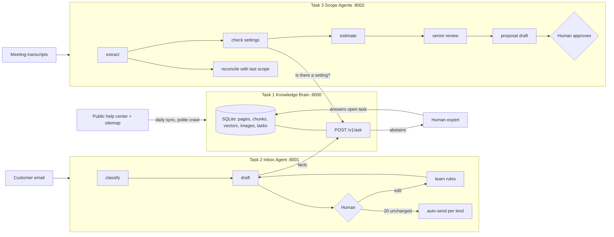

# DESIGN

## The problem, in my words
Code got cheap. A change that cost a small business $2,000 now costs about $200. A tech company can only pay the same salaries by doing 10–20× more projects, and the slow part is no longer coding. It is everything around it: knowing the product, answering every email correctly and fast, and turning a long call into something a developer can estimate. So I built three connected tools that remove those three bottlenecks, and made them improve from human feedback instead of staying frozen.

Needs nobody wrote down, which I designed for:
- **A wrong answer is worse than a slow one.** Every component can say "I don't know" and route to a human instead of guessing.
- **The help center changes.** Removed articles must disappear from answers, and a broken sitemap must not wipe the memory.
- **Trust must be earned and revocable.** Auto-sending email is a privilege per kind of email, lost on quality drops.
- **The cheapest scope is a setting the product already has.** Task 3 checks Task 1 before pricing custom code, and shows the client the saving.
- **Scope creep is silent.** Meeting 2 produces a visible list: changed / new (quoted extra) / dropped.

## How the three tasks connect

Tasks 2 and 3 only use `POST /v1/ask` (HTTP, optional `X-API-Key`). If Task 1 is down, both degrade safely: Task 2 forces human review, Task 3 adds a risk note that estimates may be too high.

## Task 1: Knowledge Brain
**Choices.** SQLite (rows + FTS5 BM25 + vector blobs in one file) instead of a vector DB: ~10k chunks fit in memory, and one file is easy to run and back up. Local `bge-small` embeddings (no API cost, nothing leaves the machine). Hybrid search (BM25 + vectors, rank-fused) because product terms ("CNAME", "Page Types") need exact matches while questions are phrased loosely.
**Polite crawl.** One global rate limit (1 req/s + jitter) shared by both workers, robots.txt, `Retry-After`, and automatic slow-down on 429/5xx. Every URL lives in a `crawl_queue` table and a page is committed before it is marked done, so a crash resumes where it stopped.
**Images.** Each screenshot is captioned once by Claude (cached by image hash) and stored as its own searchable chunk linked to its article. Without a key it falls back to alt text and does not download images.
**Daily freshness.** Compare sitemap `lastmod` with memory: new/changed pages are fetched, unchanged content hash skips re-embedding, missing pages have their chunks and vectors deleted. The sync refuses to delete more than 25% (min 5) at once, because that signals a broken sitemap.
**Answers.** Claude answers from numbered sources in a JSON schema, cites `used_sources`, and sets `can_answer=false` when sources do not contain the answer. That opens an expert task (duplicates merged). The expert's answer is stored as a first-class page that ranks slightly higher.

## Task 2: Inbox Agent
**Pipeline.** classify (Haiku) → ask Task 1 → draft (Sonnet, JSON schema) → human sends / edits / writes own → learn.
**What it learns.** Each edit becomes 0–2 short rules ("Open with the answer"), stored one row each, injected into the next prompt, and individually undoable in the UI. Past replies of the same kind are included as examples.
**"Same kind"** = the classifier's 12 kinds. **"Unchanged"** = text similarity ≥ 0.97 after ignoring case and whitespace (a changed number fails it). **20 in a row** earns auto-send for that kind. Refund, cancellation, complaint, legal, billing and quote never auto-send. Auto-send also needs confidence ≥ 0.8, no risk flags and a verified KB answer.
**Losing it.** One "wrong" spot check (10% of auto-sent mail is re-read), or 3 edits in the last 10 human-handled emails of that kind, removes autopilot and restarts the streak.
**Safety.** Email text is data: prompt-injection phrases are flagged and force human review. KB down or "I don't know" caps confidence at 0.5 so it can never auto-send.

## Task 3: Scope Agents
**Roles (one job each).** Extractor (per transcript chunk), KB checker (calls Task 1), Estimator, Clarifier, Senior reviewer, Reconciler (meeting 2 vs agreed scope), Proposal writer. Handoffs are JSON with stable ids (R1…, T1…).
**Long transcripts.** Split on speaker turns into ~6k-char windows with 2 turns of overlap, extract in parallel, merge near-duplicates.
**Money is code, not model.** Prices, totals, the 15% PM/QA margin and day counts are computed deterministically; the model only supplies task hours and prose.
**Update, don't restart.** Meeting 2 reconciles against the agreed scope: requirement ids stay stable, unchanged items are not re-estimated or re-checked, new items become `change_request` and are priced separately.
**Human gate.** Versions are `draft` until a named person approves; the export endpoint returns 409 for anything else.

## Models (what is decided vs proven)
Haiku for classification, captions, reconciliation (cheap, high volume); Sonnet for answers, drafts, estimates, review. These are **hypotheses**: the 20–30 evals per decision the brief asks for have not been run because no API key was available while building. The comparison harness is the first thing to run with a key.

## Features dropped, and why
- Real Gmail/SMTP: needs OAuth; sending writes to an outbox table behind one function.
- Vector DB / knowledge graph: unnecessary at 1.5k articles.
- Auto-detection of "same kind" beyond 12 kinds: more kinds means streaks never reach 20.
- Voice/recording pipeline for transcripts: out of scope; paste text.

## What breaks (known)
- Claude paths are untested live. Offline fallbacks are crude (see EVALS.md).
- The cosine gate for "I don't know" is weak with `bge-small` (off-topic questions scored ~0.58 in a 30-page sample); the real gate is Claude's `can_answer`.
- Screenshots with sign-in-only URLs may not download; those get alt text only.
- Auto-send similarity is character-based, so a meaning-changing edit with few characters (e.g. "can" → "cannot") can look "unchanged". A semantic check would fix it.
- Estimates from the offline fallback are flat defaults and meaningless; only Claude estimates should be shown to anyone.
- Transcripts in `task3-scope-agents/transcripts` are scripted by me, not recorded with a friend.

## Next
Run the model-comparison evals with a key; add a semantic "unchanged" check; Gmail integration; rotate the spot-check rate by kind; Salesforce-style CRM export of approved scopes.
